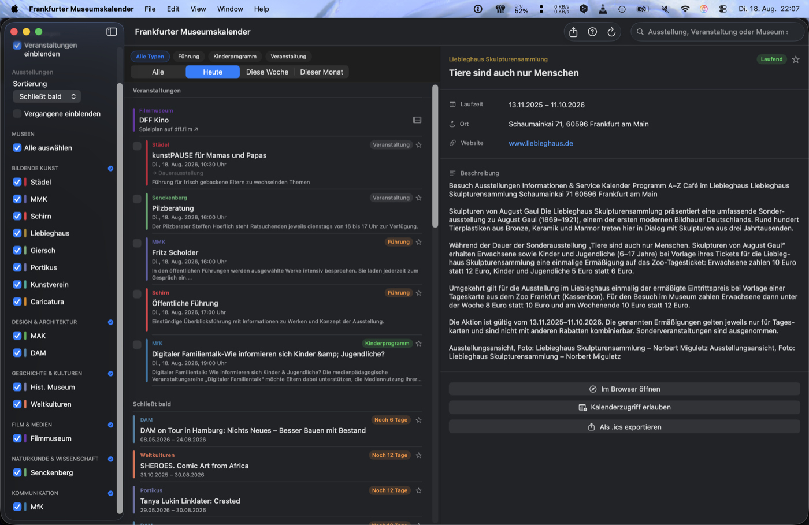
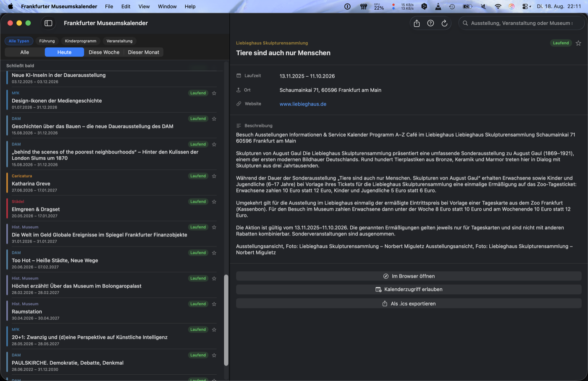

# Frankfurt Museum Calendar

Eine macOS-App, die aktuelle Ausstellungen und Veranstaltungen aus Frankfurter Museen an einem Ort zusammenführt.





## Features

- **Ausstellungsübersicht** – laufende, bald schließende und kommende Ausstellungen aus 15 Museen, täglich aktualisiert
- **Veranstaltungskalender** – Führungen, Vorträge, Eröffnungen und mehr aus allen unterstützten Häusern
- **Kalender-Export** – Ausstellungen und Events direkt in Apple Kalender oder als .ics-Datei exportieren
- **Favoriten** – interessante Ausstellungen und Events mit einem Stern markieren und gefiltert anzeigen
- **Museumsfilter** – Auswahl nach einzelnen Häusern oder Kategorien (Bildende Kunst, Geschichte, Naturkunde …)
- **Sortierung** – Ausstellungen nach Enddatum oder alphabetisch sortieren
- **Detailansicht** – Beschreibungen, Laufzeiten und Direktlinks zur Museum-Website

## Unterstützte Museen

| Museum | Kategorie |
|---|---|
| Städel Museum | Bildende Kunst |
| Museum für Moderne Kunst (MMK) | Bildende Kunst |
| Schirn Kunsthalle Frankfurt | Bildende Kunst |
| Liebieghaus Skulpturensammlung | Bildende Kunst |
| Museum Giersch der Goethe-Universität | Bildende Kunst |
| Portikus | Bildende Kunst |
| Frankfurter Kunstverein | Bildende Kunst |
| Caricatura – Museum für Komische Kunst | Bildende Kunst |
| Museum Angewandte Kunst (MAK) | Design & Architektur |
| Deutsches Architekturmuseum (DAM) | Design & Architektur |
| Historisches Museum Frankfurt | Geschichte & Kulturen |
| Museum der Weltkulturen | Geschichte & Kulturen |
| Deutsches Filmmuseum | Film & Medien |
| Senckenberg Naturmuseum Frankfurt | Naturkunde & Wissenschaft |
| Museum für Kommunikation Frankfurt (MfK) | Kommunikation |

## Voraussetzungen

- macOS 15 oder neuer
- Xcode 16 oder neuer

## Bauen & Starten

```bash
git clone https://github.com/Hendrik-Cv/FrankfurtMuseumCalendarMac.git
cd FrankfurtMuseumCalendarMac
open FrankfurtMuseumCalendarMac.xcodeproj
```

Dann in Xcode `⌘R` drücken. Die App lädt beim ersten Start automatisch alle Ausstellungen und Veranstaltungen.

## Architektur

Die App ist in reinem SwiftUI geschrieben und nutzt Swift Concurrency (`async`/`await`) für alle Netzwerkzugriffe.

```
Models/
  Museum.swift          – statisches Museum-Datenmodell mit Kategorien
  Exhibition.swift      – Ausstellungsmodell
  MuseumEvent.swift     – Veranstaltungsmodell

Services/
  ExhibitionStore.swift – @Observable Store; koordiniert Fetch & State
  *Fetcher.swift        – je ein Fetcher pro Museum (HTML-Scraping oder API)
  HTMLFetcher.swift     – HTTP-Utilities, HTML-Parser, Beschreibungsextraktion
  ICalExporter.swift    – EventKit- und .ics-Export

Views/
  ContentView.swift         – NavigationSplitView (Sidebar | Liste | Detail)
  SidebarView.swift         – Museumsauswahl, Filter, Sortierung
  ExhibitionDetailView.swift
  EventDetailView.swift
```

Jedes Museum hat einen eigenen Fetcher, der entweder eine öffentliche REST-API, WordPress-Endpunkte oder die Museumswebsite direkt parst. Beschreibungen werden aus JSON-LD, Open-Graph-Tags oder Fließtext extrahiert.

## Tastaturkürzel

| Kürzel | Aktion |
|---|---|
| `⌘R` | Ausstellungen und Events aktualisieren |
| `⌘⇧W` | Einführungsbildschirm anzeigen |

## Lizenz

MIT
